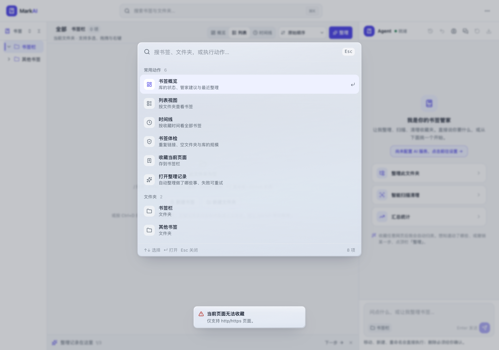
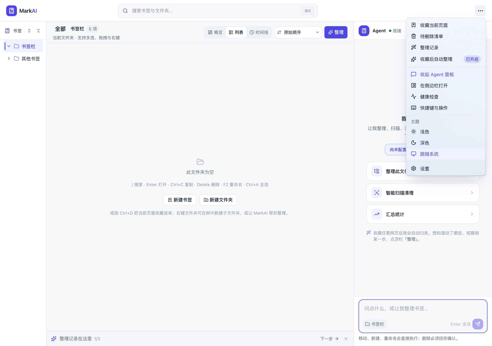
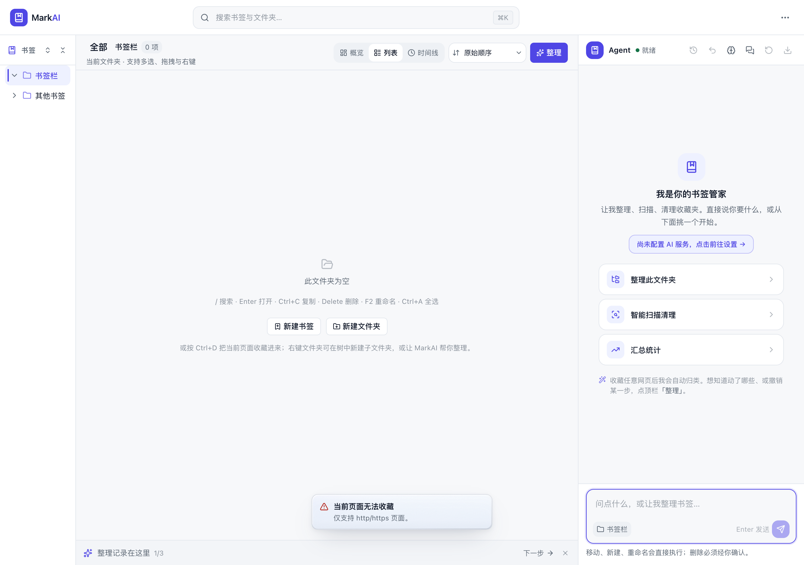
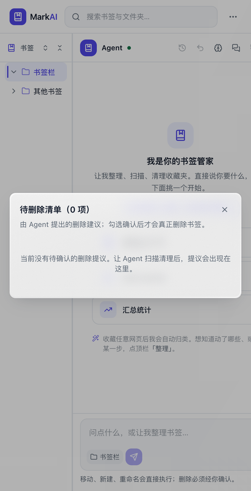
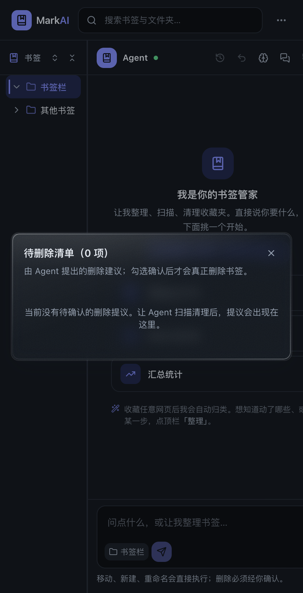
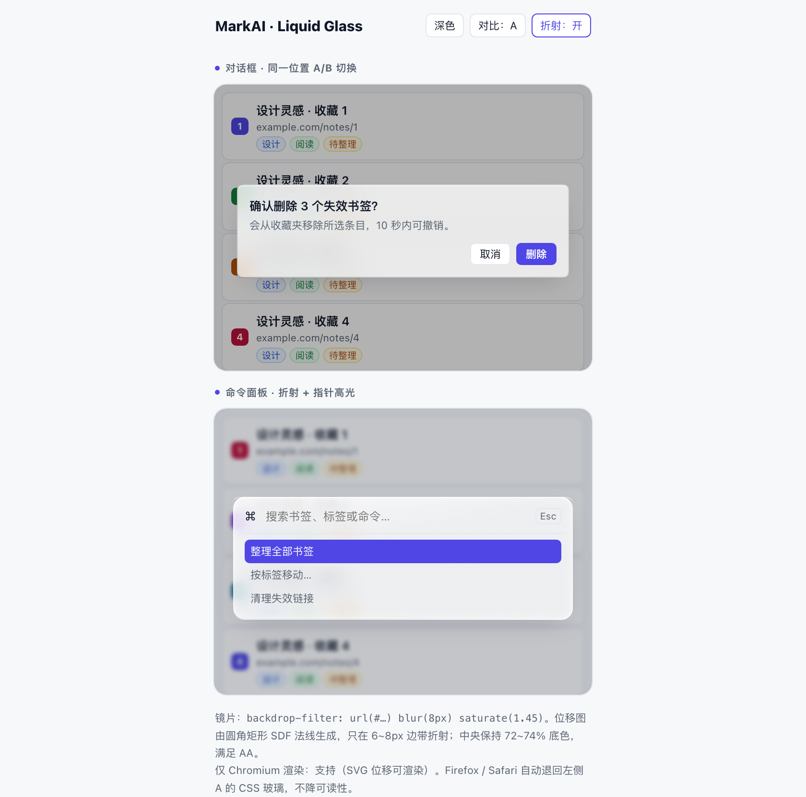
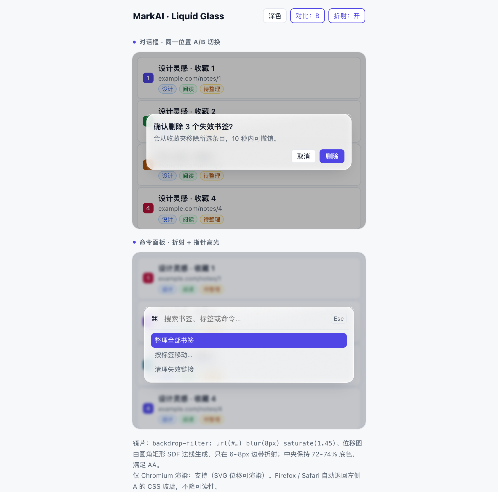
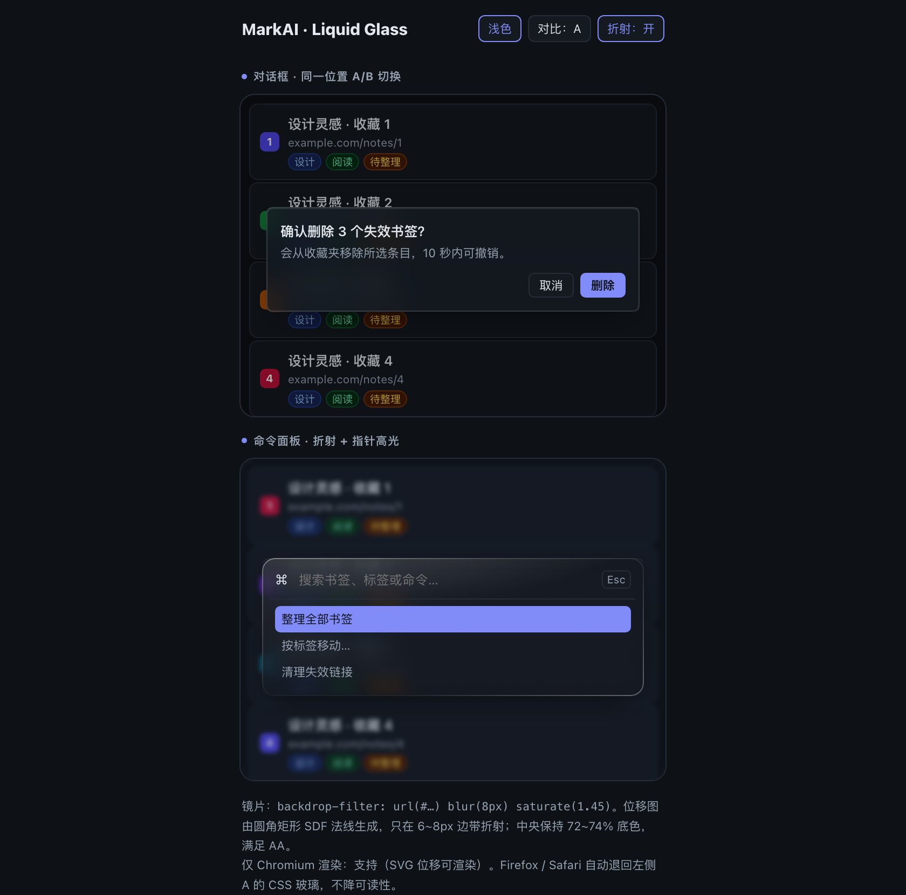
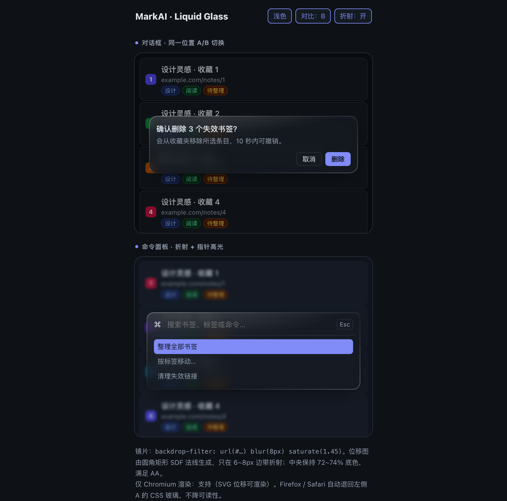

# MarkAI 液态玻璃（Liquid Glass）选型与落地方案

> **⚠️ 2026-11-14 实测修正（重要）**
> `backdrop-filter: url(#filter)` 在**普通网页**（file:// / http）里能折射（Chrome 156 实测通过），
> 但在 **chrome-extension:// 页面**里会被 Chromium 静默丢弃：`CSS.supports` 返回 true、computed style 也显示 `url(#f)`，
> 实际背景却完全不采样（同页 `filter: url(#f)` 正常，只有 backdrop 版本失效）。headless 与带窗口模式都复现。
> 因此 MarkAI 最终采用的是**光学玻璃层**（真实模糊 + 厚边色散 + 指针反光），不是 SVG 折射。
> 下面的 SVG 章节保留为调研记录，不能直接用于扩展页面；文中“已实现”的描述以第 0 节为准。

> 目标：给 MarkAI 这套 WXT + React 19 + Tailwind v4 的侧边栏插件，找 **已经在开源项目里被验证过** 的液态玻璃做法，并筛出能真正落在这个 420px 窄面板上的那一档。
>
> 结论先行：**纯 CSS 的「真折射」只有 Chromium 能渲染**（`backdrop-filter: url(#svgFilter)`）；MarkAI 又只能在浮层上做玻璃（侧边栏看不到网页本体）。所以最合适的不是照搬某个 WebGL 库，而是：
> 1. 保留现有 `markai-glass` 的模糊底色（AA 线不能破）；
> 2. 叠加 **SVG 位移折射 + 1px 高光描边 + 指针高光 + 颗粒**，只给对话框与命令面板；
> 3. Firefox / Safari 走回退，菜单、Toast 不参与折射（它们会跟着滚动内容重绘）。
>
> 可直接打开原型：`docs/prototypes/liquid-glass.html`（浅/深色、A/B 同位置对比、折射开关）；截图在 `docs/prototypes/shot-*.png`。

---

## 0. 落地状态（已实现 · 2026-11-14）

| 改动 | 文件 | 说明 |
| --- | --- | --- |
| 光学玻璃层 | [main.css](../src/assets/main.css#L503) | 真实模糊（`blur(8px) saturate(1.8) brightness(1.02)`）+ 5px 厚边色散（冷/暖两色）+ 内高光 + 外投影；深浅色 token 两套 |
| 指针反光 | [liquid-glass-global.ts](../src/lib/ui/liquid-glass-global.ts) | 文档级 `pointermove`，只给最近的 `.markai-glass-liquid` 写 `--liquid-mx/--liquid-my`；无观察器、无 rAF |
| 应用点 | 对话框、命令面板、Toast、更多菜单、工作区下拉、书签树菜单、列表批量条、聊天快捷面板 | 全部挂 `markai-glass-liquid` |
| 回归测试 | [agent.test.ts](../tests/agent.test.ts) | 全局覆盖 + 深浅 token + 「禁止 backdrop url」+ 指针反光 |

真实扩展（Chrome for Testing 156，headless / 带窗口均验证）：

- `backdrop-filter: url(#f)` 在扩展页会把背景丢成空白；`filter: url(#f)` 正常 —— 这是扩展页面的渲染限制。
- 改为光学层后：面板有真实背景模糊、5px 厚边（左冷右暖）、内高光与指针反光；所有浮层一致。
- e2e **201/201** 通过；单测 **1050** 项通过。

| 真实扩展 · 命令面板 | 真实扩展 · 更多菜单 | 真实扩展 · Toast |
| --- | --- | --- |
|  |  |  |

| 真实扩展 · 对话框 | 深色对话框 |
| --- | --- |
|  |  |

---

## 1. 本地问题画像

| 项 | 事实 | 影响 |
| --- | --- | --- |
| 形态 | Chrome Side Panel 扩展（[wxt.config.ts](../wxt.config.ts) `side_panel`），另有 Firefox 构建 | 面板是独立渲染面，**看不到背后的网页**；玻璃只能折射面板内部内容 |
| 技术栈 | React 19 / Tailwind v4 / WXT / shadcn 风格组件 | 只能吃 CSS + DOM，不能引入需要构建管线的组件库 |
| 现有玻璃 | [main.css](../src/assets/main.css#L466) `.markai-glass`：72% 底色 + `blur(12px) saturate(1.4)` + 1px inset 高光 | 已经踩过「低透明度小字不达 AA」的坑，72% 是硬约束 |
| 使用位置 | 对话框 [dialog.tsx](../src/components/ui/dialog.tsx#L91)、命令面板 [command-palette.tsx](../src/components/command/command-palette.tsx#L255)、Toast [toast.tsx](../src/components/toast/toast.tsx#L29)、菜单 [more-menu.tsx](../src/components/workspace/more-menu.tsx#L169)、工作区弹层 [workspace.tsx](../src/components/workspace/workspace.tsx#L403)、书签树菜单 [bookmark-tree.tsx](../src/components/sidebar/bookmark-tree.tsx#L1253)、底部操作条 [bookmark-list.tsx](../src/components/bookmark-list/bookmark-list.tsx#L1420)、聊天快捷面板 [chat-panel.tsx](../src/components/chat/chat-panel.tsx#L713) | 共 9 处；只有带 scrim 的对话框/命令面板适合上折射 |
| 约束 | 字号 11–12px 为主；[tests/agent.test.ts](../tests/agent.test.ts#L16874) 有对比度断言；动画 150–180ms | 折射不能压过可读性；开窗动画期间不能反复重建滤镜 |
| 主题 | 浅色 #f7f8fa 白卡、深色 #0e1116 冷灰 | 玻璃在浅色下几乎无对比可折射，必须靠描边/高光撑住「玻璃感」 |

**关键判断**：MarkAI 的浅色背景大多是白卡片，纯折射几乎看不出来。真正能读出「液态玻璃」的是 **边缘那一圈高光 + 边缘压缩/弯折 + 指针扫过的高光**，而不是整块透明。所以方案的重心是「边缘」，不是「更透」。

### 视觉对照（原型截图，420px 面板，2x）

| A · 现状 `markai-glass` | B · 液态玻璃（6px 边带折射） |
| --- | --- |
|  |  |
|  |  |

读图要点：

- A 的对话框能看出「磨砂」，但边界只是一条 1px 线；B 在上/左/下三边有一圈被弯折的亮边，右下角的高光收口更像玻璃。
- 边带一旦放到 11–14px，浅色列表左侧的彩色 favicon 会被压成一条饱和色带（实测很显眼，像污渍）；**6–8px 是这套密度的合适上限**。
- 深色下 B 的边缘高光要压到 30% 左右，否则整块发灰。

---

## 2. 检索路径

GitHub CLI 为主（`gh search repos` / `gh api`），辅以官方文档与两篇实现分析文。检索词族：

```bash
gh search repos "liquid glass" --archived=false --sort stars --limit 20
gh search repos "glassmorphism" --sort stars --limit 15
gh search repos "tailwind glass ui" --sort stars --limit 12
gh search repos "backdrop-filter svg" --sort stars
```

- 检索面：repo 元数据 → README → 关键源码文件（filter 组合、位移图生成、回退 CSS）→ issues / PR → 官方文档。
- **未使用子代理**：问题只落在一个生态（Web CSS/React 玻璃渲染），且本地约束（扩展面板、AA、窄面板）决定取舍，拆分会重复同一批搜索。所有结论均由主代理直接读源码/issue 并与本地渲染实验对照。
- 在线预览逐个用 `curl -o /dev/null -w '%{http_code}'` 验证（结果见表）。

---

## 3. 候选项目表（2026-11-14 数据）

| 项目 | 技术路线 | Stars / Forks | License | 最近提交 | 在线预览 | 结论 |
| --- | --- | --- | --- | --- | --- | --- |
| [archisvaze/liquid-glass](https://github.com/archisvaze/liquid-glass) | SVG `feDisplacementMap` + 物理厚度/IOR + 高光层，`backdrop-filter: url(#f)`，可导出一段 CSS | 837 / 59 | MIT | 2026-11-10 | [liquidglass.archisvaze.com](https://liquidglass.archisvaze.com) ✅ 200 | **主参考**：参数模型与滤镜结构直接可用 |
| [shuding/liquid-glass](https://github.com/shuding/liquid-glass) | 最小实现：圆角矩形 SDF → canvas 位移图 → `backdrop-filter: url(#f) blur(.25px)...` | 1230 / 60 | MIT | 2026-03-26 | v0 聊天 demo（无独立站点） | **结构参考**：证明 `url()` 后可继续叠加 `blur/saturate` |
| [DavidHDev/react-bits · GlassSurface](https://github.com/DavidHDev/react-bits) | 三通道位移（RGB 色散）+ CSS 回退（rim/sheen/mask），WebGL 可选 | 51875 / 2610 | MIT + Commons Clause | 2026-11-13 | [reactbits.dev](https://reactbits.dev) ✅ 200 | **回退与描边参考**；MarkAI 现有玻璃已引用其 CSS 回退 |
| [rdev/liquid-glass-react](https://github.com/rdev/liquid-glass-react) | React 组件，位移贴图 + 弹性/悬停 | 6686 / 441 | MIT | 2025-06-13 | [liquid-glass.maxrovensky.com](https://liquid-glass.maxrovensky.com) ✅ 200 | **不引入依赖**：见 issue #3/#20/#23 |
| [AndrewPrifer/liquid-dom](https://github.com/AndrewPrifer/liquid-dom) | WebGPU 渲染 + DOM-in-canvas | 2589 / 123 | MIT | 2026-09-06 | [liquid-dom-showcase](https://liquid-dom-showcase.vercel.app) ✅ 200 | **不适用**：需 `navigator.gpu` 且 DOM 内容需 Chrome `#canvas-draw-element` flag |
| [dashersw/liquid-glass-js](https://github.com/dashersw/liquid-glass-js) | WebGL + html2canvas 采样整页 | 1779 / 131 | MIT | 2025-06-12 | [dashersw.github.io](https://dashersw.github.io/liquid-glass-js/) ✅ 200 | **不适用**：采样整页在常驻面板里代价过高，且已停更 |
| [iyinchao/liquid-glass-studio](https://github.com/iyinchao/liquid-glass-studio) | WebGL2/WebGPU 全参数（Fresnel/色散/超椭圆） | 827 / 59 | MIT | 2026-09-11 | [vercel demo](https://liquid-glass-studio.vercel.app/) ⚠️ 402 | **仅作视觉参考**；预览当前不可用 |
| [naughtyduk/liquidGL](https://github.com/naughtyduk/liquidGL) | WebGL/WebGPU 放大镜式玻璃 | 1061 / 63 | NOASSERTION | 2026-10-01 | [liquidgl.naughtyduk.com](https://liquidgl.naughtyduk.com) ✅ 200 | 参考；许可证不明确，不复制代码 |
| [ybouane/liquidglass](https://github.com/ybouane/liquidglass) | WebGL 折射/色散/光照 | 621 / 46 | 无 | 2026-09-30 | [liquid-glass.ybouane.com](https://liquid-glass.ybouane.com/) ✅ 200 | 参考；无许可证，不复制 |
| [themesberg/glass-ui](https://github.com/themesberg/glass-ui) | 早期 glassmorphism CSS 库，仓库现为文档站 | 414 / 14 | 无 | 2026-02-27 | [ui.glass](https://ui.glass) ❌ 000 | 淘汰：无许可证、站点已挂 |

> 另：Compose / Flutter / React Native / iOS 的液态玻璃实现（`Kyant0/AndroidLiquidGlass`、`sdegenaar/liquid_glass_widgets` 等）与 Web 插件无关，未进表。

---

## 4. 关键证据（读源码 / issue 得到的）

1. **`backdrop-filter` 可以吃 SVG 滤镜，且能叠加普通滤镜函数**
   - archisvaze 的导出代码：`backdrop-filter: url(#liquid-glass-filter)`（[index.html#L452-L453](https://github.com/archisvaze/liquid-glass/blob/main/index.html#L452-L453)）。
   - 滤镜链：`feGaussianBlur` → `feImage`（位移图）→ `feDisplacementMap` → `feColorMatrix(saturate)` → 高光层 `feComposite/feBlend`（[index.html#L383-L399](https://github.com/archisvaze/liquid-glass/blob/main/index.html#L383-L399)）。
   - shuding 的最小版把 `url()` 与 `blur/contrast/brightness/saturate` 串在一起（[liquid-glass.js#L70](https://github.com/shuding/liquid-glass/blob/main/liquid-glass.js#L70)），证明顺序可用：先折射、后磨砂。

2. **色散（chromatic aberration）靠「三张不同 scale 的位移图 + 通道分挑 + screen 混合」**
   - react-bits `GlassSurface` 的 filter：3 个 `feDisplacementMap` + 3 个 `feColorMatrix` + 2 次 `feBlend(screen)`（[GlassSurface.jsx#L747-L795](https://github.com/DavidHDev/react-bits/blob/main/src/content/Components/GlassSurface/GlassSurface.jsx#L747-L795)）。
   - **坑**：如果只保留一条通道矩阵、忘了 `feBlend`，整块玻璃会变成纯蓝色（原型第一版就踩了，见第 7 节）。色散只适合大面板，三通道是 3 倍位移开销。

3. **回退与描边有一套成熟的纯 CSS 写法**
   - react-bits 回退档：`backdrop-filter: blur(12px) saturate(...) brightness(1.04)` + 多层 inset shadow；rim 用 `padding + mask-composite: exclude` 画 1px 渐变边；sheen 用 135° 渐变（[GlassSurface.css#L77-L160](https://github.com/DavidHDev/react-bits/blob/main/src/content/Components/GlassSurface/GlassSurface.css#L77-L160)）。
   - 这套写法不依赖任何浏览器特性，可直接给 Firefox/Safari 用。

4. **社区对现成 React 组件的负面证据**
   - [#23 "unusable. made purely for demo"](https://github.com/rdev/liquid-glass-react/issues/23)
   - [#3 "frame drops when browsing with Chrome"](https://github.com/rdev/liquid-glass-react/issues/3)
   - [#20 强制 `translate(-50%,-50%)` 定位，无法在布局里摆](https://github.com/rdev/liquid-glass-react/issues/20)
   - [#28 "Possible CSS-only alternative to SVG-based LiquidGlass?" 至今无解](https://github.com/rdev/liquid-glass-react/issues/28)
   - 结论：**借技术，不引依赖**。

5. **别的实现也不适合常驻面板**
   - liquid-dom 的 README 明写：渲染需要 WebGPU；DOM 内容还要 Chrome 的 `chrome://flags/#canvas-draw-element`（[README](https://github.com/AndrewPrifer/liquid-dom)）。
   - liquid-glass-js 需要 `html2canvas` 把页面采成纹理（[README](https://github.com/dashersw/liquid-glass-js)），常驻侧边栏会持续吃 GPU/内存。
   - 行业实现文档也给出同样结论：SVG 折射路径 **性能开销大、必须准备回退**（[tdstuff 分析](https://tdstuff.com/reading/liquid-glass-on-the-web-with-svg-displacement-maps)、[Priority Vision 的回退说明](http://www.priority.vision/docs/essence/troubleshooting-liquid-glass-fallback)）。

6. **跨浏览器现状**
   - MDN 兼容数据里，SVG 滤镜挂到 `backdrop-filter` 上在 Firefox / Safari 不生效（该记录自 2024-08 起未关闭；[MDN backdrop-filter](https://developer.mozilla.org/en-US/docs/Web/CSS/backdrop-filter)）。
   - 所以特性检测必须是运行时 `CSS.supports('backdrop-filter','url(#x)')`，不能只写 `@supports (backdrop-filter: blur(1px))`——后者在 Firefox 也为真，会拿到「没有折射、也没有回退磨砂」的半成品。
   - `corner-shape: squircle` 仅 Chrome 139+（[Chrome 139 release notes](https://developer.chrome.com/release-notes/139)），只能当锦上添花。

---

## 5. 推荐方案：三档，按“有没有文字”分

| 档 | 用在哪 | 做什么 | 代价 |
| --- | --- | --- | --- |
| **A. 现状玻璃（保留）** | 菜单、Toast、列表内浮动操作条、聊天快捷面板 | 72% 底色 + `blur(12px) saturate(1.4)` + 1px inset 高光 | 0 |
| **B. 液态描边（所有浏览器）** | 上述全部浮层 | A 之上再加：1px 渐变 rim（`mask-composite: exclude`）、指针跟随高光、极轻颗粒、`corner-shape: squircle`（Chrome 139+） | 纯 CSS，无重绘风险 |
| **C. 光学玻璃（所有 Chromium）** | 所有浮层 | `backdrop-filter: blur(8px) saturate(1.8)` + 5px 厚边色散 + 内高光 + 指针反光 | 纯 CSS + 一个 pointermove 监听，零滤镜重建 |

**明确不做**：
- 不给侧边栏容器本身做玻璃（扩展页面看不到网页，只会糊到自己的纯色底）。
- 不给 Toast / 菜单加折射：它们会随列表滚动改变背景，Chrome 需要重采样滤镜区域，掉帧风险最高（对应 rdev #3 的教训）。
- 不引入 WebGL/WebGPU 常驻渲染（liquid-dom、liquid-glass-js、liquid-glass-studio 都排除）。

---

## 6. 落地改动（最小集）

### 6.1 新增 token（`src/assets/main.css` 的 `@theme` / `.dark`）

```css
:root {
  --liquid-tint: rgb(255 255 255 / 0.72); /* 与现有 glass-surface 同值，AA 线不动 */
  --liquid-blur: 8px;
  --liquid-saturate: 1.45;
  --liquid-rim-a: rgb(255 255 255 / 0.92);
  --liquid-rim-b: rgb(255 255 255 / 0.10);
  --liquid-sheen: rgb(255 255 255 / 0.5);
  --liquid-grain: 0.045;
  --liquid-map-bezel: 7px;
  --liquid-map-scale: 6px;
}
.dark {
  --liquid-tint: rgb(21 26 33 / 0.72);
  --liquid-rim-a: rgb(255 255 255 / 0.34);
  --liquid-rim-b: rgb(255 255 255 / 0.04);
  --liquid-sheen: rgb(255 255 255 / 0.16);
}
```

### 6.2 玻璃层（满铺 tint，不做“清边”）

```css
.markai-glass-liquid {
  backdrop-filter: var(--liquid-filter, none) blur(var(--liquid-blur)) saturate(var(--liquid-saturate));
  background: var(--liquid-tint);
  box-shadow:
    inset 0 1px 0 var(--glass-highlight),                  /* 上沿高光 */
    inset 0 -1px 0 rgb(16 24 40 / 0.06),                   /* 下沿暗边：白底上单靠白高光看不见 */
    0 0 0 1px rgb(16 24 40 / 0.06),                        /* 外发丝边 */
    inset 0 0 10px 1px color-mix(in srgb, var(--liquid-tint) 70%, transparent),
    var(--shadow-lg);
}
/* Chrome 139+：连续曲率；不支持时只剩 border-radius，不报错 */
@supports (corner-shape: squircle) { .markai-glass-liquid { corner-shape: squircle; } }
```

- 不要再把 tint 缩进 2px 做“清边”。实测那 2px 会把背景里的图标/色块压成一条饱和细条，看起来像脏边；Apple 的清边更窄、且靠 rim 高光收口。
- rim / sheen / grain 用三个伪元素或三个子层，`pointer-events:none`，rim 用 `mask-composite: exclude`（写法见原型）。

> 注意：`.markai-glass-liquid` 不要写进 `@layer`。现有 `.markai-glass` 就是放在 layer 外，否则组件上的 `shadow-*` 工具类会把玻璃高光盖掉（[main.css](../src/assets/main.css#L466) 的注释已记过这个坑）。

### 6.3 Chrome 位移滤镜（调研记录，扩展页面不可用）

位移图 = 圆角矩形 SDF 的法线，只在边带（bezel）里有值：

```ts
// 从 docs/prototypes/liquid-glass.html 的 displacementMap() 直接搬
function displacementMap(w: number, h: number, radius: number, bezel: number) {
  const scale = Math.min(1, 320 / Math.max(w, h)); // 半分辨率，双线性放大足够
  // ...逐像素计算 SDF 法线，编码到 R/G 通道（128 为原点）
  return { url: canvas.toDataURL(), w, h };
}
```

滤镜结构（单通道、无色散，给文字面板）：

```xml
<filter id="..." x="0%" y="0%" width="100%" height="100%" color-interpolation-filters="sRGB">
  <feImage href="data:image/png;base64,..." x="0" y="0" width="354" height="128"
           preserveAspectRatio="none" result="map"/>
  <feDisplacementMap in="SourceGraphic" in2="map" scale="6"
                     xChannelSelector="R" yChannelSelector="G"/>
</filter>
```

命令面板想要色散时，再把单条 `feDisplacementMap` 换成 react-bits 的三通道结构，**务必保留 `feBlend(screen)`**。

### 6.4 应用范围

```diff
- className="markai-glass animate-scale-in ... rounded-lg p-4"
+ className="markai-glass markai-glass-liquid animate-fade-in ... rounded-lg p-4"
```

- 对话框：[dialog.tsx](../src/components/ui/dialog.tsx#L91)
- 命令面板：[command-palette.tsx](../src/components/command/command-palette.tsx#L255)
- `animate-scale-in` 换成 `animate-fade-in`：`scale` 动画会让 `backdrop-filter` 每帧重采样，是这类效果最容易掉帧的场景（见 rdev #3 与 tdstuff 的性能段）；淡入只重绘 tint 层。
- 面板本身不滚动：对话框把 `overflow-y-auto + max-h` 移到内层，外层只负责玻璃。否则 `::before` 的 rim 属于滚动内容，长对话框一滚高光边就跟着滚走（实测过）。

Firefox / Safari：不设置 `--liquid-filter`，`.markai-glass-liquid` 自然退化成 `blur(8px)` 版本；再用 B 档的 rim/sheen 保住观感。

---

## 7. 本地验证（已完成）

环境：Chrome 157.0.8103.79（headless，`--force-device-scale-factor=2`）。

| 检查 | 结果 |
| --- | --- |
| `CSS.supports('backdrop-filter','url(#f)')` | `true` |
| `CSS.supports('backdrop-filter','url(#f) blur(8px) saturate(1.4)')` | `true` |
| `CSS.supports('-webkit-backdrop-filter','url(#f)')` | `false` → SVG 折射必须用无前缀属性 |
| `CSS.supports('corner-shape','squircle')` | `true` |
| 高对比条纹下的渲染 | 边缘出现压缩/弯折，中央保持清晰（[refraction-proof.html](prototypes/refraction-proof.html)） |
| 位移图生成 300×140 | 首次 7.8ms，稳定后 ≈3.0ms（含 `toDataURL`） |
| 位移图生成 150×70（半分辨率） | ≈1.3ms |
| 位移图生成 640×420 | ≈9.1ms |
| 位移图生成 2048×512 | ≈25.8ms → **大面板必须限分辨率** |
| 每个浮层重建 | ≈6ms（含 DOM 插入 + 样式写入）→ 放在 `ResizeObserver` 里 140ms 防抖，别塞进开窗动画 |

原型的两个坑（已修）：
1. 零色散时若只留最后一条通道矩阵，整块面板变纯蓝 → **必须有 `feBlend(screen)` 或退回单次位移**；
2. `.glass-liquid` 里写 `position: relative` 会覆盖 `.dialog` 的 `absolute`，把浮层拽回文档流。

---

## 8. 风险与未验证项

| 风险 | 说明 | 处理 |
| --- | --- | --- |
| 扩展 CSP 与 `feImage` data URI | MV3 默认 `extension_pages` CSP 不限制 `img-src`，但需实测 | 装 unpacked 打开对话框；若被拦，改用 `Blob` URL 或 `feTurbulence` 近似（形状精度下降） |
| 首帧卡顿 | 滤镜重建 6ms + 首次绘制 | 半分辨率、按尺寸缓存、动画结束后再挂 `--liquid-filter` |
| 浅色主题“看不出折射” | 白卡背景本身没有可折射的细节 | 靠 rim/sheen/grain；折射只当边缘细节，不指望整块透明 |
| 深色主题色块透底 | 26% 透底 + `saturate 1.45` 会把彩色 favicon / 标签透成橙色光斑 | 深色 tint 抬到 0.78，或把对话框 scrim 从 `black/30` 提到 `/40`；面板宽 < 240px 时关色散 |
| Firefox 半成品 | 有 `backdrop-filter`、无 `url()` | 运行时特性检测 + 不给 `--liquid-filter`，保留 blur 回退 |
| 滚动背景上的浮层 | 菜单/Toast 会重采样 | 这两类不加折射 |

---

## 9. 参考来源

**开源实现**
- archisvaze/liquid-glass — https://github.com/archisvaze/liquid-glass
- shuding/liquid-glass — https://github.com/shuding/liquid-glass
- DavidHDev/react-bits（GlassSurface）— https://github.com/DavidHDev/react-bits
- rdev/liquid-glass-react（及 issue #3 / #20 / #23 / #28）— https://github.com/rdev/liquid-glass-react
- AndrewPrifer/liquid-dom — https://github.com/AndrewPrifer/liquid-dom
- dashersw/liquid-glass-js — https://github.com/dashersw/liquid-glass-js
- iyinchao/liquid-glass-studio — https://github.com/iyinchao/liquid-glass-studio
- naughtyduk/liquidGL — https://github.com/naughtyduk/liquidGL
- ybouane/liquidglass — https://github.com/ybouane/liquidglass
- themesberg/glass-ui — https://github.com/themesberg/glass-ui

**文档**
- MDN `backdrop-filter` — https://developer.mozilla.org/en-US/docs/Web/CSS/backdrop-filter
- Chrome 139 release notes（`corner-shape`）— https://developer.chrome.com/release-notes/139
- Liquid Glass on the Web with SVG Displacement Maps — https://tdstuff.com/reading/liquid-glass-on-the-web-with-svg-displacement-maps
- Priority Vision 的 Liquid Glass 回退说明 — http://www.priority.vision/docs/essence/troubleshooting-liquid-glass-fallback

**本地实验**
- 原型：`docs/prototypes/liquid-glass.html`
- 高对比折射实验：`docs/prototypes/refraction-proof.html`（高对比条纹实验，可直接打开）
