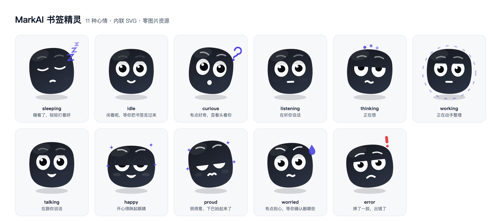

# v0.2.169 — 书签精灵

一只常驻在角落的书签形小角色。它不随机卖萌：**每一个表情都对应一件真实发生的事**。

> 深色主题版本：[pet-states-dark.png](prototypes/pet-states-dark.png)。
> 两张图都由 `npx tsx scripts/pet-sheet.ts` 从**同一份几何**生成，不是手画的示意图。

## 十一种心情

| 心情 | 触发条件 | 表现 |
| --- | --- | --- |
| `listening` | 搜索框 / 聊天输入框有焦点 | 眼睛张望、嘴成一条线 |
| `thinking` | `connecting` / `thinking` / `retrying` | 眯眼 + 头顶三个点 |
| `working` | `tool` 相（正在调工具） | 半眯、呆毛后压 + 虚线转环 |
| `talking` | 回复正在流式出字 | 咧嘴 |
| `worried` | 有待确认的删除提议 | 眉头内扣 + 汗滴 |
| `happy` | 刚成功（收藏 / 整理 / 撤销） | 眯眼笑 + 腮红 + 星 |
| `proud` | 被撸了一把（双击） | 抬下巴、呆毛甩到另一边 |
| `error` | 请求失败 / 书签加载失败 | 皱眉 + 红色感叹号 |
| `curious` | 闲置 45 秒 | 歪头 + 问号 |
| `sleeping` | 闲置 8 分钟 | 闭眼、慢呼吸 + Z |
| `idle` | 其它 | 微笑、呼吸 |

## 为什么它不卡

这是这次改造里唯一值得单独说的技术点：**分两层做动画**。

| 层 | 内容 | 实现 | 代价 |
| --- | --- | --- | --- |
| 环境层 | 呼吸、悬浮、眨眼、特效 | CSS keyframes | **合成器线程**，主线程 0 帧 |
| 反应层 | 压扁、倾斜、呆毛、瞳孔跟随、点击回弹 | 弹簧 + 单 rAF | 只在被打断时跑，判稳即停 |

- React **只在"心情变了"时重渲染一次**；每帧的姿态由 ref 直接写 DOM（`pet-avatar.tsx` 里没有 `useState`——这条被单测钉住）；
- 弹簧用半隐式欧拉 + 1/240s 固定子步：120Hz 屏和掉到 30fps 手感一致，切标签页回来的长 dt 被截断到 0.1s，不会一次冲出去；
- 判稳条件写进单测：**判稳后 `step()` 必须返回 false**，否则"空闲常驻"就会变成"永远在跑 rAF"；
- 眼珠跟随只在 `pointermove` 时唤醒 rAF，位置换算用缓存盒子，绝不在移动事件里读布局（那会强制同步布局）。

## 造型

- **深色圆角体 + 两颗大白眼**：眼神靠"白眼 / 深瞳 / 高光 / 眼皮"四个部件撑起来，
  情绪靠眉毛区分（担心=眉头抬起，出错/专注=眉头下压，平时几乎不可见）；
- **眼皮用裁切而不是缩放**：半闭眼时瞳孔不会被一起压扁（这是"活着"和"瘪了"的分界）；
- **零图片资源**：内联 SVG，两套主题只换配色变量；任意尺寸都锐利，包体不增加一个字节；
- **两个消费者共享一份坐标**（`src/lib/pet/geometry.ts`）：实时组件与表情总览图，
  改一版造型不会出现"页面新脸、配图旧脸"。

## 互动

- **单击**：按当前心情说一句（同一心情里轮转，不做随机）；气泡 6.2 秒后自己消失；
- **双击**：撸一把 → `proud`（真的切心情，不只是换台词）；
- **碎碎念**：沿用 0.2.16x 就有的频率模型（90 秒最小间隔 / 同一件事 30 分钟冷却 / 被打断静默），只在有事实可说时开口；正在流式、弹着对话框、页面不可见时一律闭嘴；
- **可关**：设置页新增「宠物」分区（显示开关 / 大小 48-56-72 / 眼珠跟随 / 主动碎碎念），预览渲染的是同一个组件。

## 验证

| 项 | 结果 |
| --- | --- |
| 单测 | **1072 项全过**（新增 [pet] 17 项：弹簧收敛/过冲/长 dt、驱动器自停、心情优先级与驻留、表情表不变量、眉毛语义（担心/出错不许画反）、CSS 覆盖、台词轮转、命令式渲染约束、设置独立落盘与挂载） |
| `tsc --noEmit` | 通过 |
| 构建 + zip | Chrome MV3 通过 |
| 真机 e2e | **本机无法完成**：playwright 缓存从 `chromium-1248` 升到 `chromium-1255` 后，0.2.168 的**已发布构建**同样在第 2 段（造数据的 `chrome.bookmarks.create`）卡在 CDP `Runtime.evaluate` 超时——是浏览器/环境问题，不是本次改动。新增的 `[9.6]` 用例（存在性 / 可访问名称 / 不遮挡控件 / 单击说话 / 双击得意）已就位，换回可用 Chrome for Testing 后可直接跑 |

## 升级注意

- 宠物默认开启；不想要就在设置页「宠物」里关掉（或把 `markai.pet.enabled` 置 false）；
- 设置独立存放于 `markai.pet` / `markai.pet.chatter`，**不与 `markai.config` 混在一起**——清空 AI 配置不会连带把宠物设置清掉。
